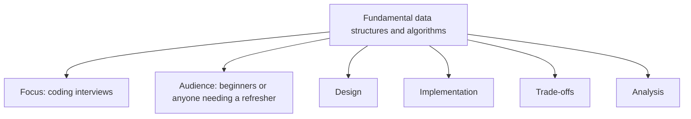
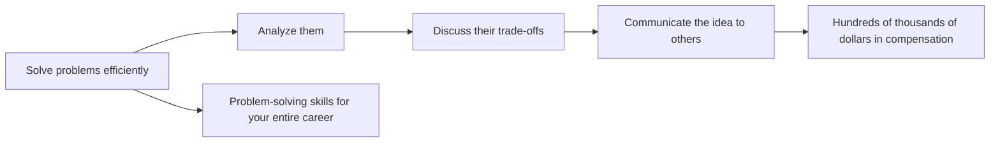
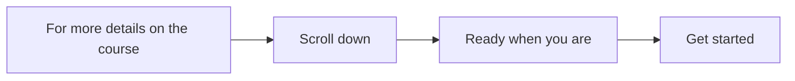
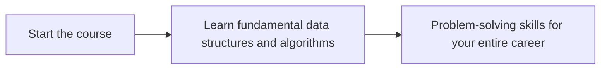

# Introduction to the Course

## What This Course Is

- Covers all the fundamental **data structures and algorithms** you need to know.
  - The focus is on **coding interviews**.
- Meant for **beginners**, or anyone who just needs a **refresher**.
- Covers the **design**, **implementation**, **trade-offs**, and **analysis** of all the common data structures and algorithms.

Being able to solve these problems efficiently, analyze them, discuss their trade-offs, and then communicate the idea to others is what can make a difference in **hundreds of thousands of dollars in compensation**.

- The **problem-solving skills** you learn in this course can serve you for your **entire career**.

## Getting Started

For more details on what the course covers, please **scroll down**.

- When you are ready, **get started**.

