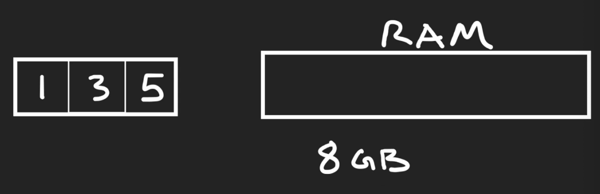
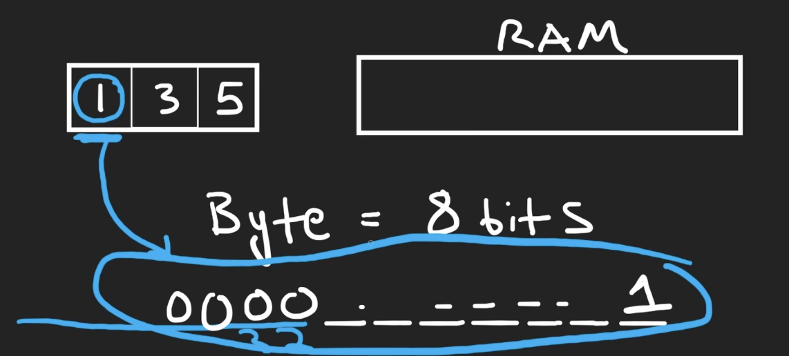
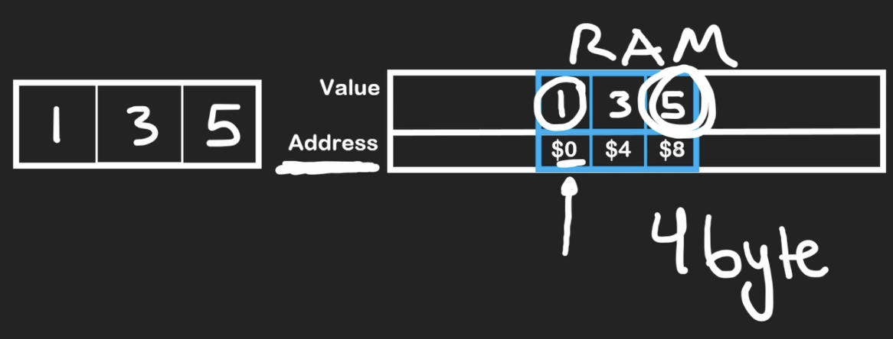
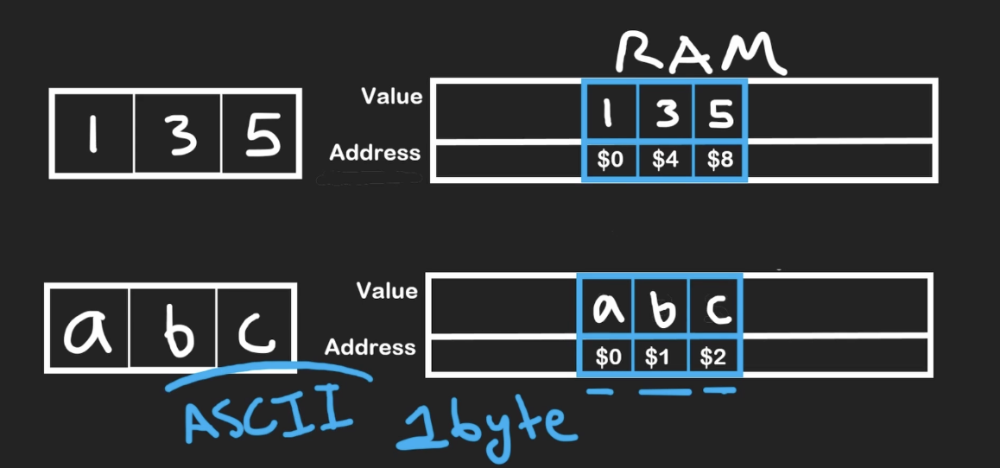

# ram

Intro lesson on arrays as a data structure: how RAM stores values in bytes at contiguous addresses, and why address offsets match value size.

RAM & Bytes Basics

RAM stores variables; measured in bytes (8 GB ≈ 10^9 bytes)

1 byte = 8 bits; a bit holds 0 or 1

Arrays in Memory

Values stored contiguously at distinct addresses

Int array: address increments by 4 (32-bit ints = 4 bytes each)

Integer 1 represented as 31 zeros followed by a 1

Char array (ASCII): address increments by 1 (1 byte each)

Arrays are the simplest data structure — in-memory layout matches usage

