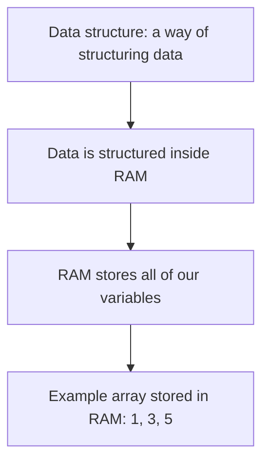
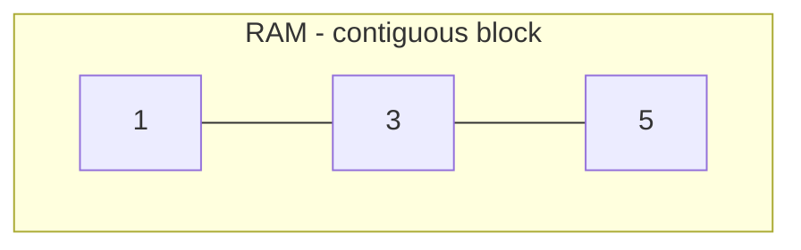
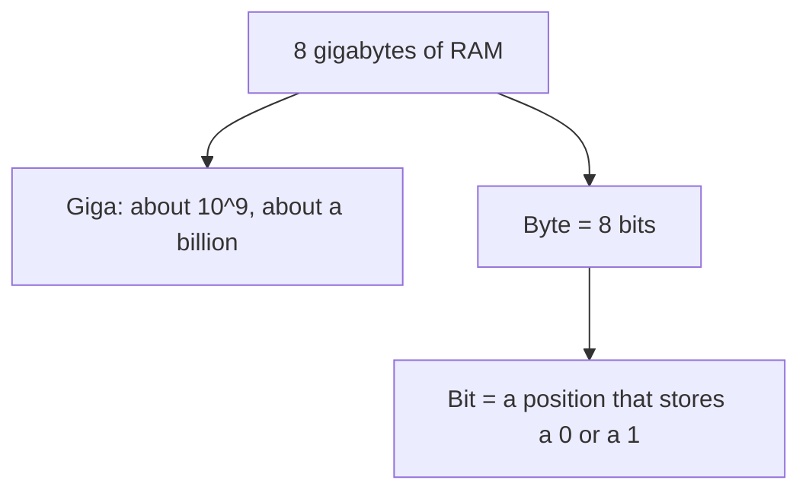
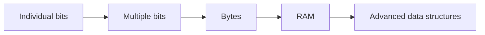
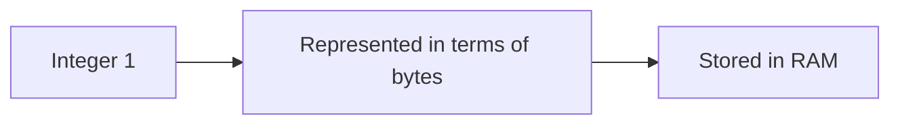
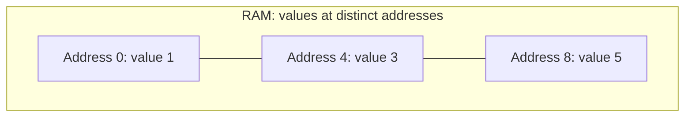
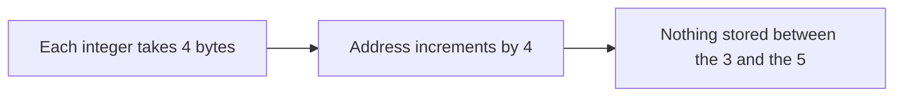
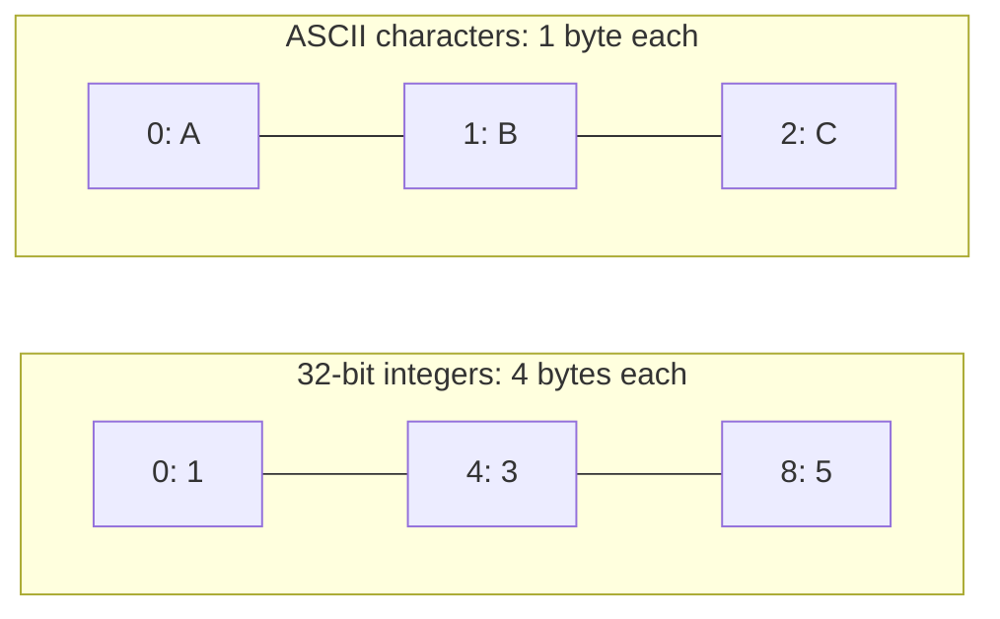
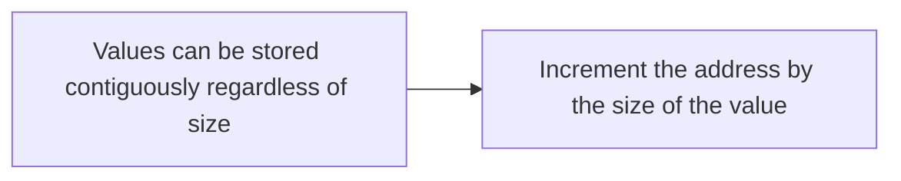
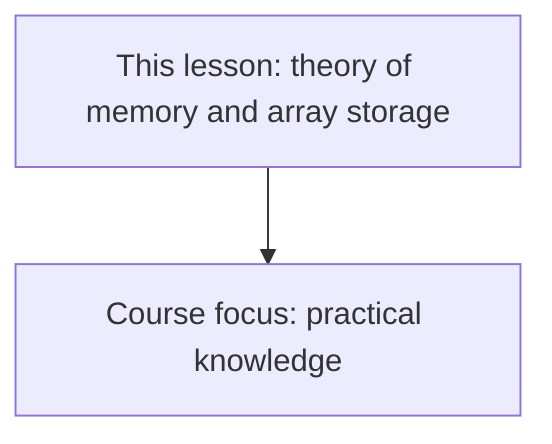

# RAM and How Arrays Are Stored in Memory

## What Is a Data Structure?

The first data structure covered in this course is **arrays**. Before getting into arrays, we need to understand what a data structure even is. As the name implies, it is a way of **structuring data**. In this case, the data is structured inside of **RAM**.

- **RAM** is basically where all of our **variables** are stored.
- As we write code and use array data structures, the array is going to be stored in RAM.
- Example array: **1, 3, 5**. This is the information being stored.






## Bits, Bytes, and RAM Size

RAM is measured in **bytes**. It is common for many computers to have, let's say, **8 gigabytes** of RAM.

- **Giga** means about ten to the power of nine, so about a **billion**.
- A **byte** is nothing more than **8 bits**.
- A **bit** is a position that can store a digit.
  - The digit can only be a **0** or a **1**.
  - Zeros and ones are the **language of computers**.

Individual bits can form multiple bits, which can form bytes, which can form RAM, and RAM can be used to store **advanced data structures**.

```text
1 byte = 8 bits
giga ≈ 10^9 ≈ 1 billion
```





## Storing an Integer in RAM

In this case, we have an array of integers. Take the integer **1** as an example. To store it, it has to be stored in terms of bytes.

- It is pretty common for integers to be represented not by a single byte, but as **4 bytes**.
  - Instead of 8 bits, that means **32 bits** in total.
- **How 1 is represented:** 31 zeros, and then a single **1** at the very end.
  - This is covered in more depth later in the course.
- What matters is that there is a way to take the 1, represent it in terms of bytes, and put it into RAM.

```text
32-bit integer = 4 bytes = 32 bits
1 → 31 zeros, then a single 1
```




## RAM Addresses and Contiguity

RAM can be thought of as a **contiguous block of data**, and it has two components.

- **Values:** RAM stores values.
- **Addresses:** every value is stored at a distinct location, called an **address**.
  - The first address is **0**.
  - In the lesson, a dollar sign is put in front of every address to distinguish addresses from the values being stored.

When an array is stored in RAM, we do not always get to choose what location it is at. But one thing about arrays is that they are always **contiguous**.

- Example: the 1 is stored here, the 3 is stored here, and the 5 is stored here.
  - Nothing is stored in between the 3 and the 5.
- The address is incremented by **4** every time, not by 1.
  - Because each value takes **4 bytes** to store; this does not represent 1 byte, it represents 4 bytes.
  - These are **32-bit integers**, so they take 4 bytes to store.

```text
address 0 → 1
address 4 → 3
address 8 → 5
```






Arrays are considered the **most simple data structure**. In memory, they look the exact same as they do the way we use them: a **contiguous set of values**.

**Storing characters instead:**

- Example: storing characters like **ABC**.
- Characters are stored pretty much exactly the same way, contiguously as expected.
  - The address is incremented by **1** as a new character is added.
  - Because each character only takes **1 byte** to store in memory, not 4 bytes.
  - At least that is the typical case when storing **ASCII** characters, which is not super important to know.
- The general point: values can be stored contiguously regardless of how big or small they are.
  - As long as the address is incremented by the **size of the value**.

```text
address 0 → A
address 1 → B
address 2 → C
```






## Takeaway

This was definitely a lot of theory to understand, but the course is mostly going to focus on **practical knowledge**.

- We learned a bit about what **memory** is.
- We learned how **arrays** can be stored in memory.
- Next: how arrays can be used, and what exactly are their **properties and trade-offs**.



