# Static Arrays: Properties and Operations

## Review: What an Array Is

An array is a **contiguous block of data**. It is stored the same way in RAM, as a contiguous block of data. With any data structure, the two most common operations are **reading** from the data and **writing** to the data.

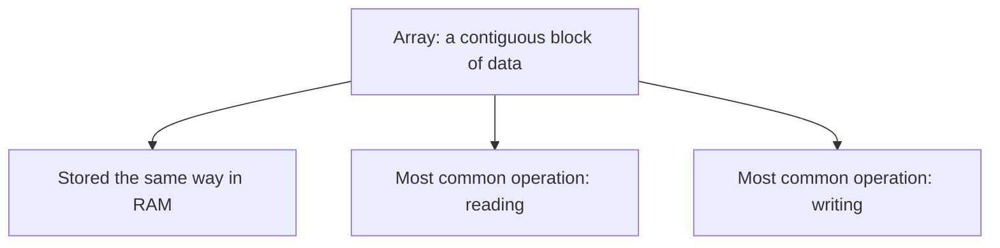

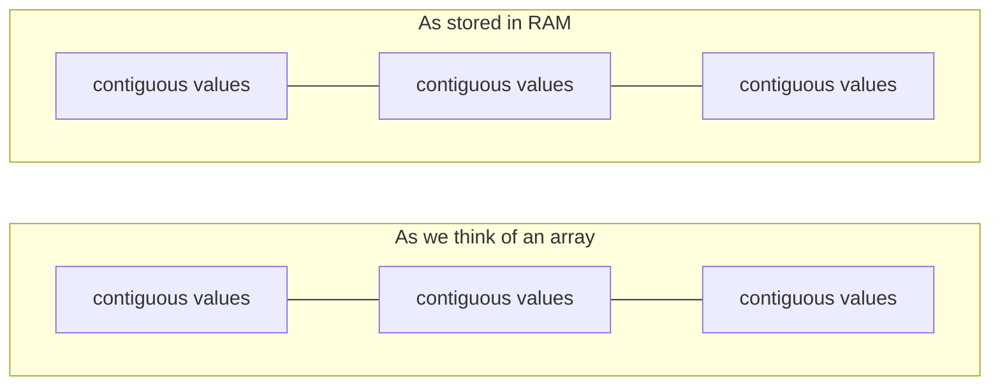

## Reading from an Array

We first handle the simple case: reading the data. Suppose we want to read the first element of the array. As a programmer, we have an array allocated as a variable, let's say **myArray**.

- To read the first element, the intuitive thing is to go to the first address in memory and read the value.
  - That is exactly what is happening under the hood.
  - But as programmers, we do not need to know the exact address of every single value; we use **indexes** to access values.
- **The first value is always at index 0, not at index 1.**
  - This can be confusing if you are a beginner, but it always starts at 0.
  - The next one is at index 1, then index 2, and so on.
- When we read the first value at index 0, it automatically goes to that location in memory and reads the value stored there.
  - Since any index in the array automatically maps to a location in memory, any value can be read **instantly** as long as we have the index.
- This efficient operation is called **Big-O of 1**.
  - Big-O notation is covered more later in the course.
  - It means: in the worst case, reading a value — assuming we have the index, say index 2 — is an **instant operation** in **constant time**.
  - No matter how big the array gets, any value in the array can be read instantly.

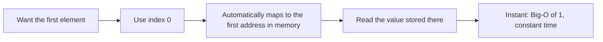

That is the oversimplified explanation so far.

**Why RAM allows this:**

- The ability to go to any arbitrary address in RAM and read the value at that address is a **property of RAM**.
  - It is in the name: **RAM stands for Random Access Memory**.
  - It basically means any portion of the memory can be randomly accessed in **constant time**.
- We do not have to start from the beginning of RAM and keep looking for the value.
  - With a lot of RAM, we do not want to go through the entire RAM every single time.
  - To access the third value, we do not want to go through the first and second values, because it is not necessary.

```text
myArray[i]
read → O(1) constant time
```

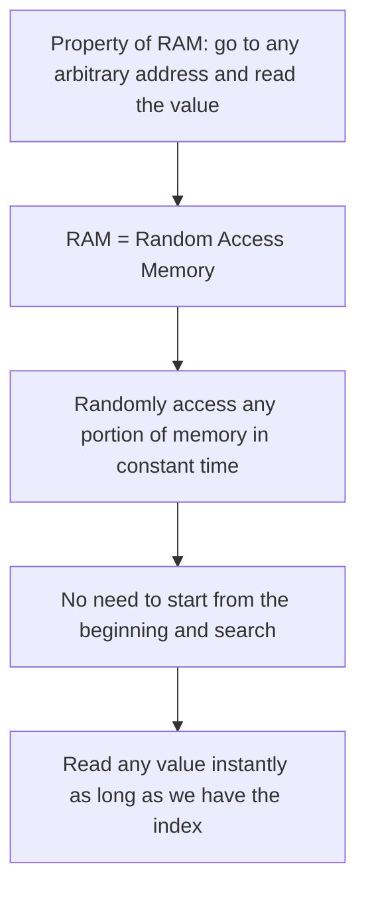

**Looping through the array:**

After reading the first value, we want to read the second value and the third value, and keep doing that until we get to the end of the array.

- The first index we start at is 0. Call it **i**.
  - In code, we typically say myArray at index i to read the value.
  - Then we increment i to 1, then to 2, and keep doing that.
  - We stop when i equals the **length of the array**.
- Essentially, we loop through the entire input array.
- In most languages, this can be done with a **for loop** or a **while loop**.

```text
i = 0
read myArray[i]
increment i → 1 → 2 → … → length of array, then stop
```

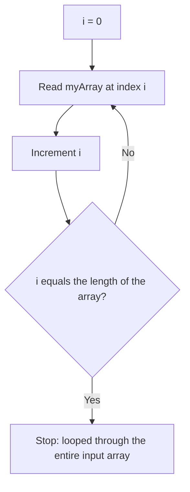

These simple ideas are going to be the **building blocks** for very advanced algorithms covered later in the course.

## Writing to an Array: Fixed Size

Writing to an array brings us to an important property of arrays: they are of **fixed size**. In this case, we declared an array of **3 values**.

- Suppose we want to add a fourth value, let's say a **7**.
  - The simple thing would be to just add a 7 in memory, but we have to make sure it is contiguous, so we would do so only at **address 12**.
  - Then we have an array of size 4, and it is still contiguous. This seems like it might work.

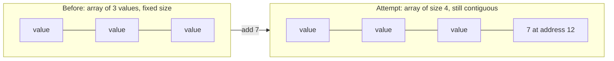

- But the way RAM works, we do not always get to decide exactly where we allocate our RAM or store our values.
  - We do not know for sure that this spot in RAM is even available for us.
  - It could be that another array is already stored there, or the **operating system** is using this part of the memory for some other purpose.
  - So we are not necessarily allowed to put the 7 there.
- Another option: let the operating system decide and just put a 7 anywhere in memory.
  - But then we do not follow the property of arrays; it is no longer **contiguous**.
  - Now we have **two arrays**. That is not what we wanted; we wanted a single array.
  - Example of why this breaks: while looping, we are at index 2, then increment to index 3.
  - Accessing that means going to this spot, but we do not know that the 7 is stored there; it might be stored somewhere else.
  - So this is going to break.

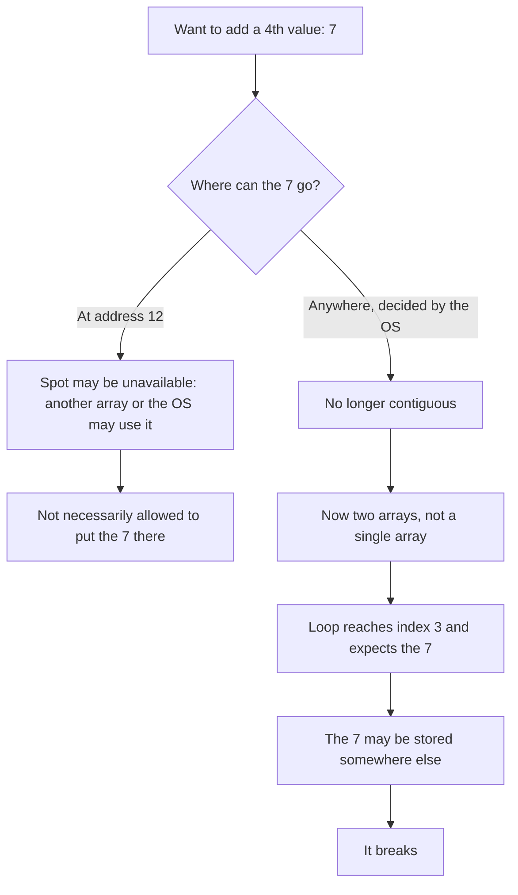

This is the **biggest limitation of arrays**, at least for **static arrays**, which are **fixed-size arrays**.

If you are used to a programming language like **Python** or **JavaScript**, you might have never come across this limitation.

- Those languages do not really offer static arrays.
- You never have to worry about running out of space when using an array.
- Those languages usually offer **dynamic arrays** as the default, which are discussed later on.

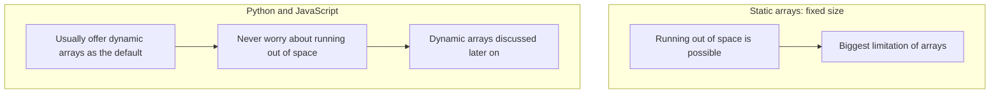

**Allocating, adding, and removing:**

Suppose we allocated an array of size 3. Initially it is empty, but there has to be something stored there.

- Languages will usually initialize it to be all **0** by default.
  - Sometimes they will not initialize it at all.
  - Sometimes there can be random arbitrary values that we did not even put there.

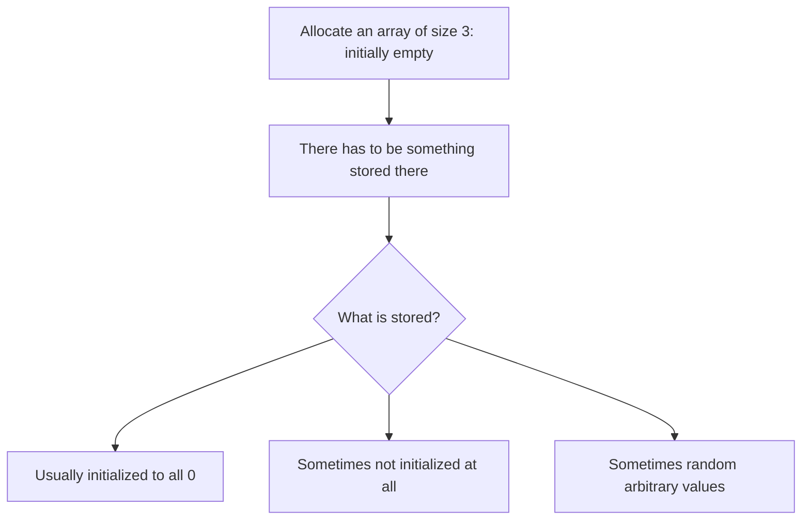

- Adding values:
  - Add a **5** → that puts a 5 in memory.
  - Add a **6** → that puts a 6 in memory.
  - Add a **7** → that puts a 7 in memory.
- Removing values:
  - With a static array, we cannot actually delete or deallocate the value in memory.
  - "Remove" means we **overwrite** it, let's say by putting a **0** in that spot.
  - We would say that the value is no longer relevant; we only care about the other values.
  - This value is still in memory, but we do not care about it.
  - We can remove all the values in a similar way.
  - What we cannot do is add a new value.

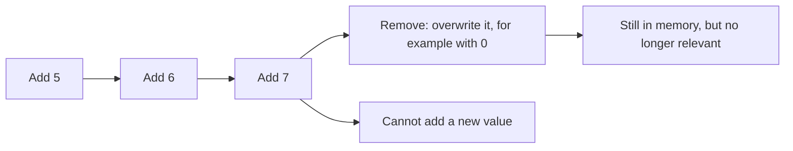

**Time complexity of writing:**

- Adding a new value to the end of the array, at the next empty spot we are keeping track of, is also an **instant operation**.
  - We know this is index 0 and this is index 1, and we want to write to this position.
  - Therefore, we know instantly that we are writing to this position in RAM.
- Writing to any position is a **Big-O of 1** operation; it is constant time. Think of it as an instant operation.
- Removing a value is also as efficient as **Big-O of 1**.
  - It is a constant time operation because we are really just going to that position in memory and crossing it out.
  - We could be replacing it with a 0, a negative 1, or something like that.
  - We are not actually deleting it; we are **overwriting** it.

```text
write myArray[i] → O(1)
insert at end    → O(1)   (assuming a space is available)
remove at end    → O(1)
```

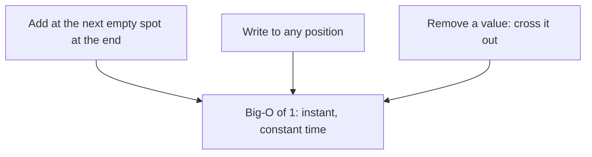

## Inserting and Removing in the Middle

The values are **ordered**: the 5 comes before the 6, and we know that because of the way the indexes work.

- We want to arbitrarily insert a value at any position in the middle of the array, any position in between the values, at the end, or at the beginning.
  - **Inserting at the end** is always efficient because we are inserting into an empty spot, if at least one is available. That is **O(1)**.
  - **Inserting at any arbitrary position**, like the middle or the beginning, is not going to be efficient.

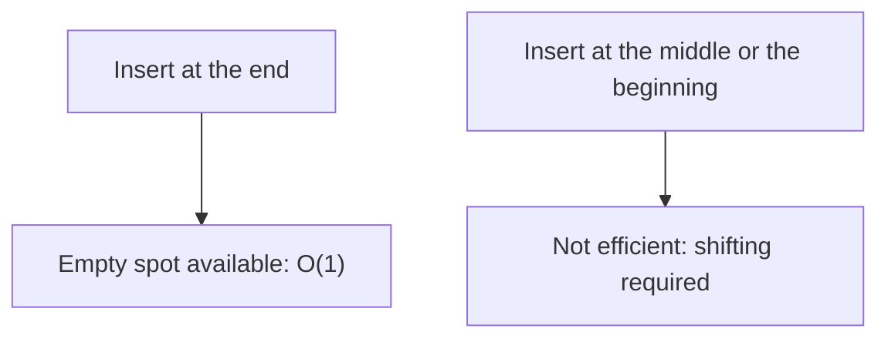

Example: insert the value **4**.

- It is easy enough to overwrite the value with a 4, but then we have a 4 and a 6.
  - What we actually want is to have **4, 5, 6**.
  - We could put the 4 at the end because that is efficient, **O(1)**, and there is space there.
  - But that does not achieve 4, 5, 6; the elements would be **out of order**.
- With arrays, including static arrays, the **order of the values does matter**.

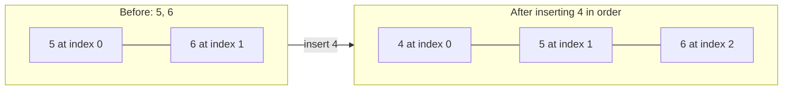

- To insert the 4 in order, we first have to shift the 5 to the next position.
  - But if we shift it there, we are going to get rid of the 6, which is not what we want.
  - So before we shift the 5, we have to shift the 6.
  - The 6 is at index 1; we set it to index 1 + 1, meaning it goes to index 2.
  - The 5 is at index 0; we set it to index 0 + 1, meaning it goes to index 1.
  - Only after performing this shifting are we allowed to put the 4 in the now-free spot.
  - There is space for it now, and we preserved the order of the values.

```text
shift 6: index 1 + 1 = 2
shift 5: index 0 + 1 = 1
insert 4 → order preserved
```

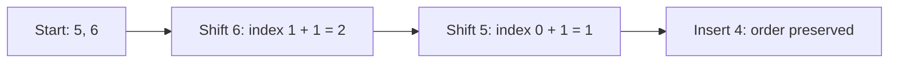

The downside is that this could not be done in a single operation. We had to move every value in the array. In this case there were only two values, but imagine a really long array filled with values: inserting a value at the beginning would mean shifting all of them, and then inserting the new value. This is not very efficient.

- We call this a **Big-O of n** operation.
  - **n** is a variable; in this problem, n refers to the **number of elements in the array**.
  - That can be called the **length of the array**: the actual values we have, not the size of the array.
- **Big-O means the worst case.**
  - What was just done was the worst case: every value in the array had to be shifted over to the right by one, meaning n values, and then the new value could be inserted.
- Not every scenario is the worst case.
  - Inserting in the middle between the 5 and the 6 — to get 5, 4, 6 — would not require shifting the 5 at all.
  - Only the 6 would have to be shifted; the 5 would stay on the left.
  - So only one value would be shifted, not every value in the array.
  - But rather than going through every possible scenario, we generalize it.
  - In the worst case, inserting a value in the middle at any arbitrary position might require shifting every value: n values.
  - So in the worst case, the time complexity is **Big-O of n**.

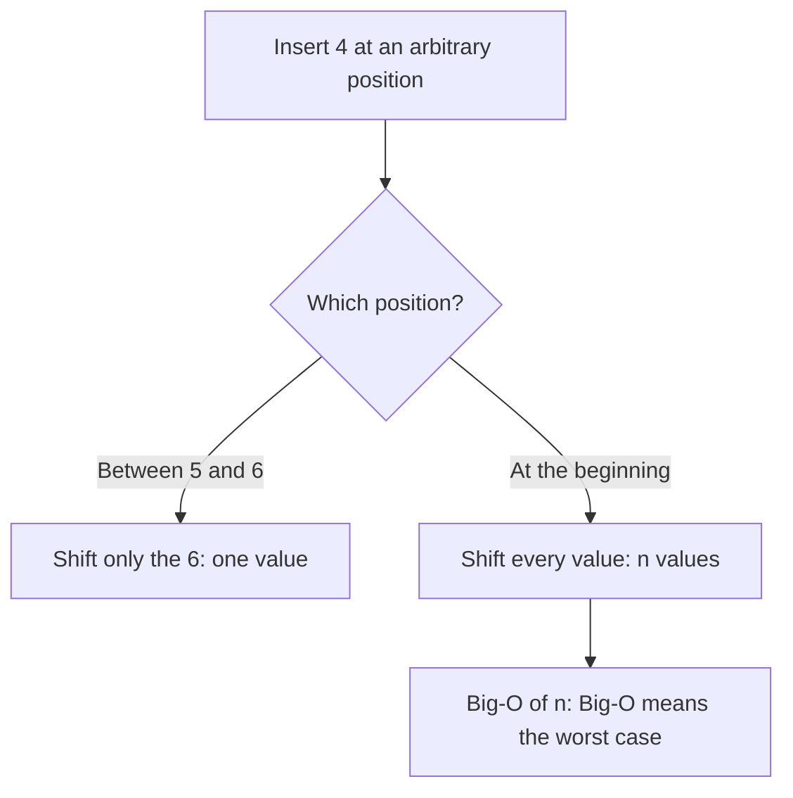

**Removing at an arbitrary index:**

The exact same thing is true when removing a value at any arbitrary index. Removing here does not mean just replacing it with a 0; it means pretending the value does not exist anymore.

- Example: we want the first value to be **6**.
  - We take the 6 and shift it to the left by one: 1 - 1 is 0, so it goes to the 0th index.
  - The 7 is at index 2; we take 2 - 1, which is 1, and move it to that index.
  - In the end, we are left with **6, 7**.
- Technically, the 7 from the old position would still be there.
  - We could have replaced it with a 0, or done something to pretend it does not exist.
  - But the memory that was actually allocated definitely does exist, and it would be reflected in RAM.

```text
shift 6: index 1 - 1 = 0
shift 7: index 2 - 1 = 1
result: 6, 7
```

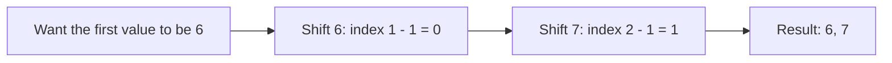

## Summary: Static Array Operations

- **Read or overwrite the ith element:** **Big-O of 1**, constant time.
  - **ith** basically means any arbitrary element; you could pick any index and read or write from it.
- **Insert at the end:** **Big-O of 1**, assuming there is an empty space left at the end.
- **Remove at the end:** **Big-O of 1**, assuming there is at least one element at the end to remove.
- **Insert in the middle:** in the worst case, **Big-O of n**.
  - For an empty array, inserting in the middle would be very efficient, **Big-O of 1**.
  - But Big-O refers to the worst case, where every value might have to be shifted.
- **Remove in the middle:** **Big-O of n**, because every value might have to be shifted.

```text
read / overwrite ith   → O(1)
insert / remove at end → O(1)
insert / remove middle → O(n) worst case
```

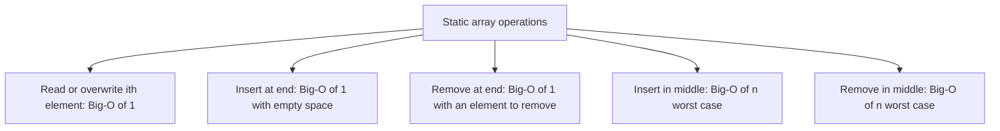

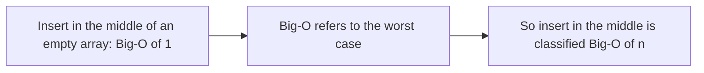
